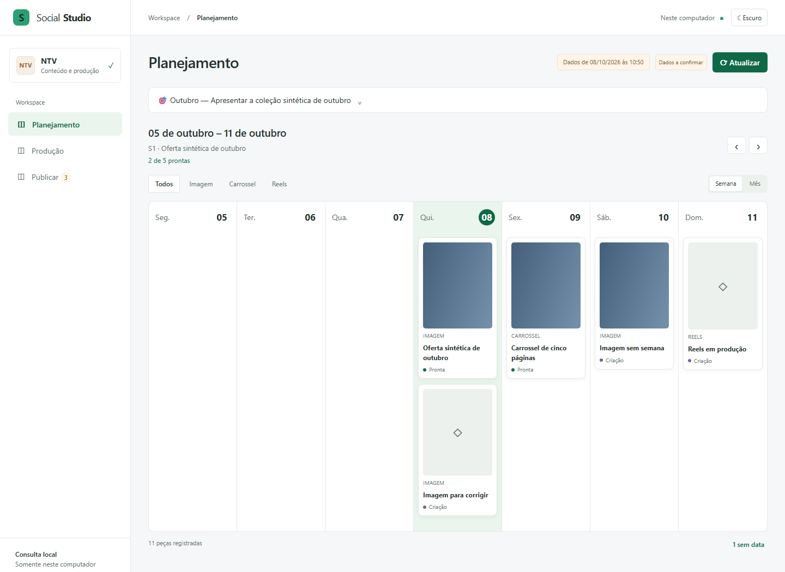

  

# Projetos de Alexandre Melo

Desenvolvo ferramentas para organizar a operação comercial, apresentar produtos e automatizar tarefas com planilhas e documentos.

Este portfólio reúne apresentações de projetos, exemplos visuais e seus estágios de desenvolvimento.

## Automação aplicada à operação

### [Catálogo de produtos em PDF](projetos/catalogo.md)
**Fase final.** Geração de quatro versões de catálogo a partir de uma planilha e das fotos dos produtos. Uma aplicação para distribuidores e operações que precisam manter materiais comerciais atualizados.

### [Builder 2.0](projetos/builder.md)
**Em construção, base funcional.** Ferramenta interna de montagem, personalização e exportação de sites. Apoia a criação de páginas a partir de componentes reutilizáveis.

## Sistemas para equipes

### [CRM comercial](projetos/crm.md)
**Em construção, base funcional em uso.** Organização da rotina de vendas, com acessos por perfil e acompanhamento comercial.

### [CRM Social](projetos/crm-social.md)
**Em construção.** Planejamento semanal e mensal, consulta da produção e prévias de conteúdo.

*Captura demonstrativa de uma versão de desenvolvimento, com conteúdo sintético.*

### [Plataforma de afiliados](projetos/afiliados.md)
**Pronto, em evolução.** Acompanhamento de indicações, compras, recompensas e solicitações de saque integrado à loja.

## Experiências de compra

### [Ta Hora](projetos/ta-hora.md)
**Pronto, em evolução.** Loja com catálogo, carrinho e checkout integrado à Shopify.

### [NTVBox](projetos/ntv.md)
**Pronto.** Página de venda com apresentação do produto, elementos 3D e caminho até o checkout.

## Como ler os estágios

- **Pronto:** versão implementada e entrega documentada; pode continuar recebendo melhorias.
- **Fase final:** implementação avançada, com conclusão ainda em andamento.
- **Em construção:** desenvolvimento ativo ou conclusão integral ainda pendente.

Os estágios refletem a situação documentada em outubro de 2026. Uma demonstração publicada não representa a conclusão de todas as funcionalidades planejadas.

As apresentações públicas incluem apenas informações selecionadas para o portfólio. Os códigos dos projetos privados permanecem nos respectivos repositórios restritos.

[Voltar ao perfil de Alexandre](https://github.com/Browsher)
