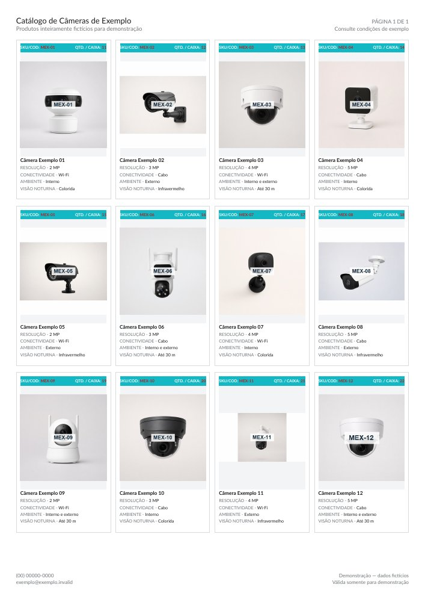

[Portfólio](../README.md) / Automação de catálogos

# De uma planilha a quatro catálogos PDF

**Estágio: fase final.**

Distribuidores precisam atualizar produtos, especificações, fotos e condições comerciais em seus materiais de venda. Quando existem versões em idiomas diferentes e apresentações com ou sem preços, cada alteração pode se repetir em vários documentos.

## A solução

O projeto usa uma planilha como base do catálogo e uma pasta para as fotos dos produtos. A geração produz quatro documentos: português com preços, português sem preços, chinês com preços e chinês sem preços.

As informações de produtos e os textos da apresentação ficam centralizados na planilha. As versões seguem a mesma estrutura visual.

## O que a automação entrega

- Catálogos organizados por produtos e categorias.
- Versões adequadas a públicos com necessidades diferentes.
- Fotos e especificações associadas aos itens da planilha.
- Geração por uma rotina de uso preparada para Windows.

## Demonstração visual

*Prévia de catálogo gerada com produtos e dados fictícios. Os dados da demonstração não representam uma oferta comercial.*

## Aplicação para negócios

Uma solução desse tipo atende operações que revisam catálogos com frequência, trabalham com distribuidores ou precisam apresentar o mesmo portfólio a públicos diferentes.

## Situação atual

O gerador está em fase final de desenvolvimento, conforme a situação atual do projeto. A demonstração apresenta a saída visual; a conclusão da entrega ainda está em andamento.

[Ver outros projetos](../README.md)
