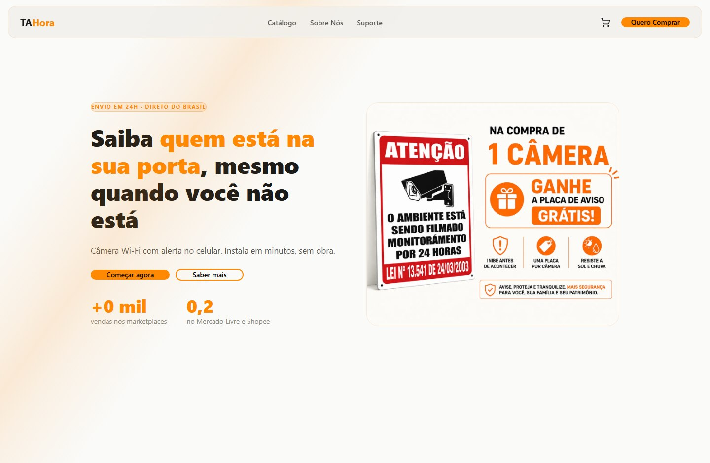

[Portfólio](../README.md) / E-commerce

# Ta Hora

**Estágio: pronto, em evolução.**

Loja de câmeras de segurança e acessórios, com apresentação de produtos, navegação de catálogo e carrinho integrado à Shopify.

*Captura da página pública em outubro de 2026. Conteúdo, produtos e condições comerciais podem mudar.*

## O que foi implementado

- Catálogo e páginas de produto conectados à loja.
- Carrinho com itens, quantidades e aplicação de cupom.
- Encaminhamento para o checkout da Shopify.
- Conteúdo de apoio à compra, navegação responsiva e páginas institucionais.

## Aplicação para negócios

Uma vitrine de produtos pode ser adaptada à identidade da marca e integrada à operação de catálogo e checkout da Shopify.

## Situação atual

A versão da loja está implementada e publicada. O projeto continua recebendo melhorias.

**[Visitar a loja Ta Hora](https://www.tahora.com.br/)**

[Ver outros projetos](../README.md)
